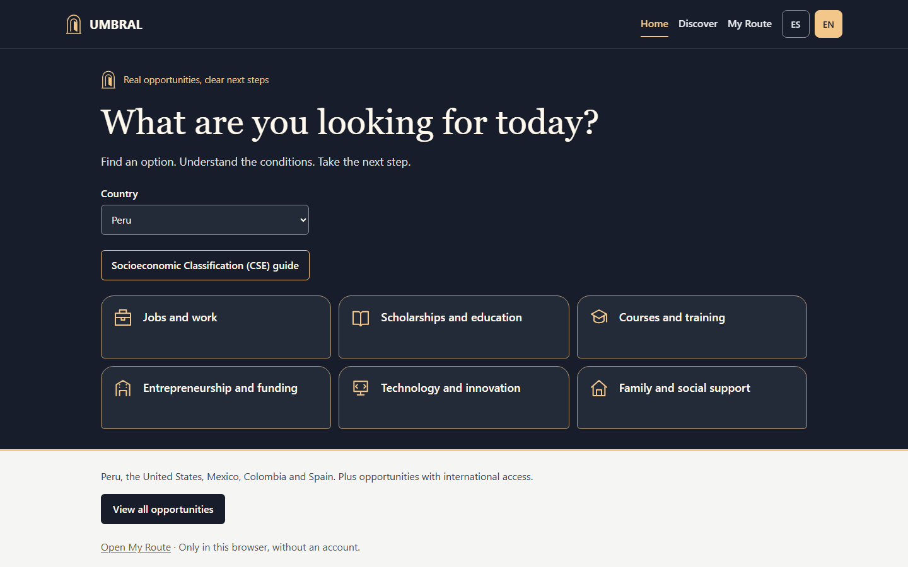
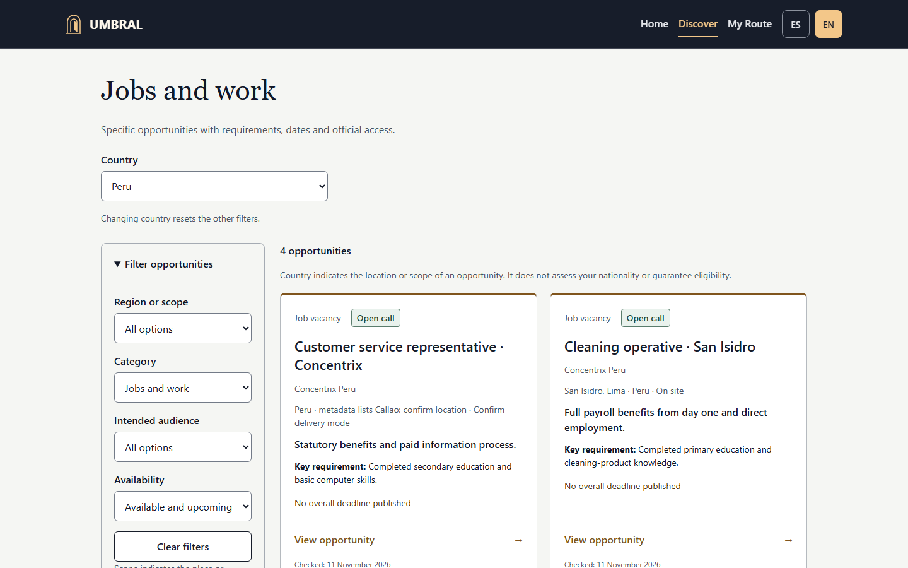
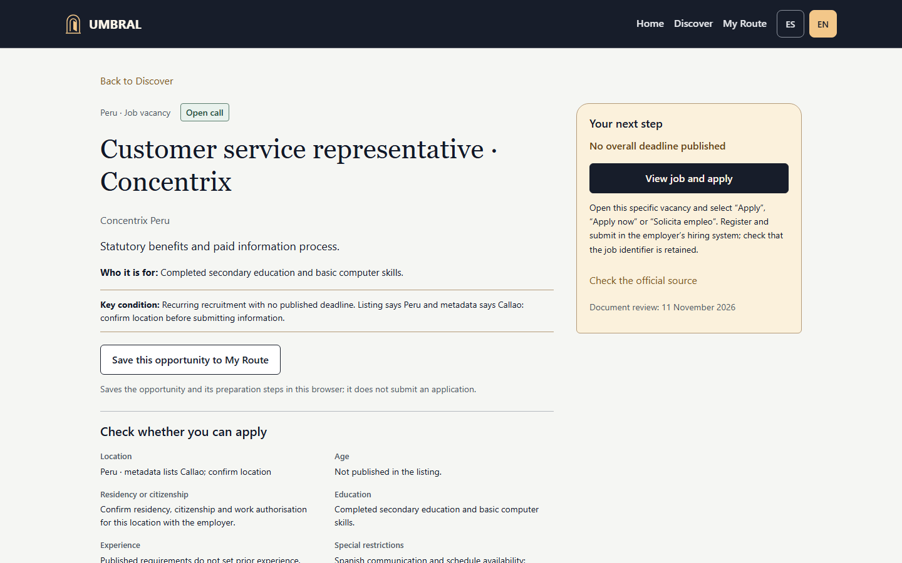
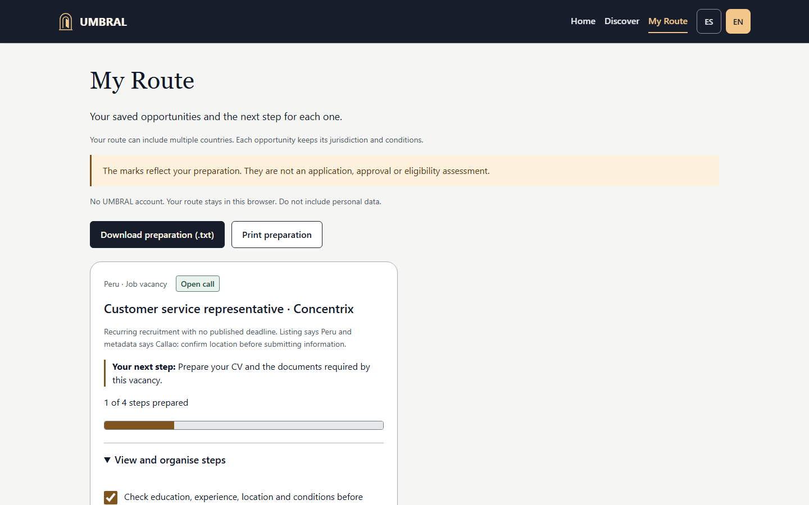
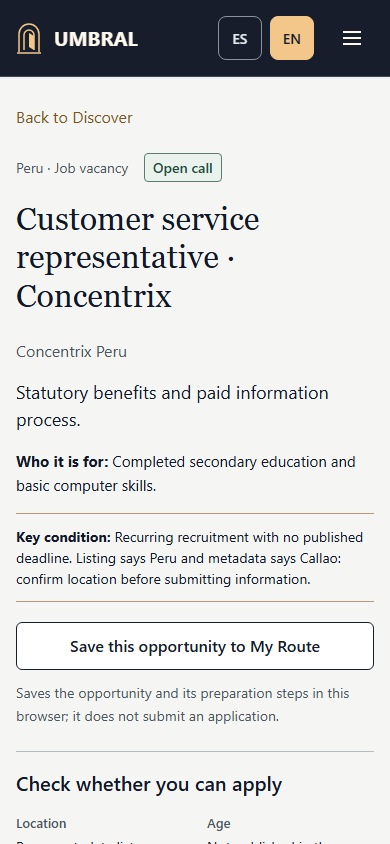
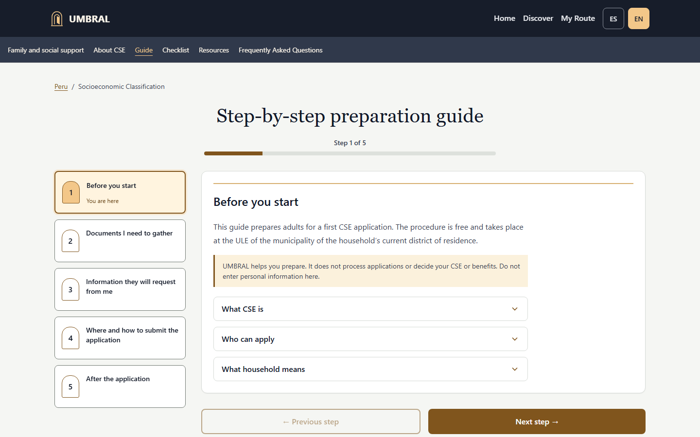

# UMBRAL — The Illuminated Threshold

**Encuentra oportunidades reales. Entiende los requisitos. Da el siguiente paso.**

[Abrir UMBRAL](https://umbral-seven-khaki.vercel.app) · [English](README.md) · [Candidatura](docs/kiroween-submission/PROJECT-OVERVIEW.md) · [GitHub](https://github.com/Alvaro-mendoza-12/Umbral)

UMBRAL es un acompañante bilingüe para estudiantes, personas que buscan empleo, quienes quieren capacitarse, emprendedores y hogares. Reúne oportunidades concretas, condiciones, fuentes oficiales fechadas y una ruta de preparación guardada en el dispositivo, sin crear una cuenta.

Encontrar un programa no siempre permite saber qué ofrece, para quién es, cuánto cuesta o qué hacer después. UMBRAL organiza esas respuestas y señala los datos no publicados. Todavía no se han demostrado resultados sociales ni realizado entrevistas de validación.



## Cómo funciona

1. Elige país y explora categorías o filtros. Español/inglés se selecciona por separado.
2. Abre una oportunidad, lee beneficio, público y condición clave; puedes guardarla en **Mi Ruta**. La ficha CSE también muestra su guía al inicio.
3. Revisa elegibilidad, restricciones, costos, fechas y fuentes. La elegibilidad completa permanece antes de la acción oficial de postulación; guardar no confirma que cumplas los requisitos.
4. Marca pasos, añade tareas y consulta el progreso. Descarga una copia de texto o imprime tu preparación.
5. Continúa en el sitio oficial para postular, inscribirte o solicitar. UMBRAL no envía la solicitud.

## Catálogo y países

La revisión editorial del **11 de noviembre de 2026** contiene **31 oportunidades concretas y el trámite CSE de Perú**. Incluye **15 vacantes**: Perú 4, Estados Unidos 2, México 3, Colombia 3 y España 3. Las oportunidades internacionales se muestran para países admitidos por sus condiciones. Cambiar idioma no cambia jurisdicción ni concede acceso internacional.

Las seis categorías son empleo, educación, capacitación, emprendimiento, tecnología y apoyo familiar. La cobertura depende del país; los estados vacíos explican la ausencia de registros. Se distinguen becas completas y parciales, cursos gratuitos y pagados, certificados profesionales y tipos de apoyo empresarial.

El catálogo es editorial, no una conexión en vivo. Incluye registros cerrados: **31 no significa 31 convocatorias abiertas**. Los cerrados y pendientes de confirmación no aparecen en la búsqueda inicial. Las fechas publicadas determinan cierres; superar la próxima revisión editorial cambia el registro a «Requiere confirmación» y oculta la acción de solicitud. Los portales generales son complementarios. **Es necesario verificar fuentes antes del envío y la evaluación**: algunas vacantes tienen revisión pendiente para el 14 de noviembre de 2026 y pasan a «Requiere confirmación» al día siguiente si no se actualizan. Consulta siempre a la institución antes de actuar.




## Funciones y experiencia visual

- Español/inglés y preferencias de país e idioma independientes.
- Fichas con beneficio, condiciones, estado, fuentes y enlaces oficiales.
- Mi Ruta con guardados locales, pasos, tareas personales, progreso, descarga e impresión.
- CSE de Perú con guía de cinco pasos, once casillas de preparación, recursos y preguntas frecuentes. Los datos de oficina de Chiclayo corresponden solo a ese distrito.
- PWA instalable y lectura sin conexión después de una primera carga completa con red. Los enlaces externos necesitan internet.
- Diseño adaptable, teclado, gestión de foco, controles semánticos, movimiento reducido y comprobaciones automáticas de accesibilidad. No equivalen a certificación WCAG completa.




**The Illuminated Threshold** utiliza una paleta nocturna misteriosa, un umbral cálido iluminado, iconos de arco, tarjetas como puertas y progreso visible. La propuesta para Kiroween es **Costume Contest**. El propietario aprobó la dirección visual; no se ha medido una mejora de usabilidad. Consulta la [justificación](docs/kiroween-submission/CATEGORY-JUSTIFICATION.md).



## Arquitectura y herramientas

Aplicación estática **React 18, TypeScript y Vite**, con React Router, i18next/react-i18next y Vite PWA/Workbox. `localStorage` conserva preferencias, Mi Ruta y checklist. No hay backend, cuentas ni API de IA en ejecución. Vercel publica el sitio con rutas SPA y cabeceras de seguridad.

| Área | Ubicación |
|---|---|
| Rutas y accesibilidad | [`src/App.tsx`](src/App.tsx) |
| Dominio, datos, estado y vistas de oportunidades | [`src/features/opportunities/`](src/features/opportunities/) |
| Contenido CSE y fuentes | [`src/content/pe/cse/`](src/content/pe/cse/) |
| Pruebas y CI | [`tests/`](tests/), [Quality](.github/workflows/quality.yml) |

Consulta la [arquitectura técnica](docs/kiroween-submission/TECHNICAL-ARCHITECTURE.md).

## Kiro y Codex

Kiro creó el MVP inicial: implementación React/TypeScript, experiencia CSE, contenido bilingüe, PWA, pruebas e informes iniciales. Se conservan los [tres Specs](.kiro/specs/umbral/) y [cinco Steering](.kiro/steering/) auténticos con su contenido original.

Codex realizó auditoría independiente, correcciones, accesibilidad y regresiones, expansión internacional y del catálogo, tema The Illuminated Threshold, ajustes posteriores de interacción y preparación de publicación. Esos cambios no se atribuyen a Kiro. No se reivindican Agent Hooks, MCP, Crew ni pruebas de propiedades sin evidencia. Consulta la [atribución](audit/ATTRIBUTION.md).

## Instalar y ejecutar

Usa **Node.js 26.x** y npm desde la raíz de este repositorio. También se admite Node 24.15.0+ dentro de 24.x. No se necesitan claves ni variables de entorno.

```sh
npm ci
npm run dev
```

Para compilar y abrir una vista previa:

```sh
npm run build
npm run preview
```

Offline requiere el build y una primera carga completa en línea; el servidor de desarrollo no valida el Service Worker de producción.

## Verificación

```sh
npm run lint
npm run test -- --run
npm run build
npm audit --omit=dev --audit-level=moderate
npx playwright install chromium
npm run test:e2e
```

El lockfile fija Playwright **1.65.0** y CI utiliza su imagen Chromium correspondiente. E2E compila y abre una vista previa aislada en `127.0.0.1:5186`. Define directorios nuevos con `UMBRAL_RESULTS_DIR` y `UMBRAL_SCREENSHOTS_DIR` para conservar evidencia previa. Consulta las [instrucciones completas](docs/kiroween-submission/TESTING-INSTRUCTIONS-EN.md).

Resultados registrados el **11 de noviembre de 2026**: **49 pruebas unitarias**, **484 E2E locales aprobadas** y **86 E2E de producción aprobadas** en vistas de 390 y 1440 px. [Quality en main](https://github.com/Alvaro-mendoza-12/Umbral/actions/runs/43136483189) terminó correctamente. Consulta la [evidencia local](docs/kiroween-submission/evidence/quality-tests.json), [de producción](docs/kiroween-submission/evidence/production-tests.json) y [del despliegue](docs/kiroween-submission/evidence/production.json). Son resultados fechados; editar documentación no implica repetir las pruebas. Las vistas móviles se emularon en navegador, no en teléfonos físicos.

## Privacidad, seguridad y límites

Los guardados y tareas permanecen en el navegador, sin sincronización ni recuperación por cuenta. Borrar datos del sitio o cambiar de navegador/dispositivo puede perder el progreso. No escribas DNI, información financiera ni datos sensibles en tareas. Un dispositivo compartido puede exponer los guardados. Las descargas e impresiones quedan bajo tu control.

UMBRAL no pide documentos de identidad, ingresos ni domicilio para evaluar elegibilidad. El hosting puede procesar metadatos técnicos; las instituciones externas aplican sus propias políticas. No se promete anonimato absoluto ni una certificación general de seguridad.

La CSE es orientación de preparación para Perú. UMBRAL no calcula ni solicita CSE, consulta padrones, concede beneficios o sustituye a una **ULE**. Las casillas miden preparación, no elegibilidad. No hay postulaciones ni evaluación de requisitos automáticas, sincronización institucional, alertas de fechas o recomendaciones con IA. La revisión documental no garantiza vigencia, contratación ni aprobación.

## Candidatura, historia y licencia

El [paquete de candidatura](docs/kiroween-submission/PROJECT-OVERVIEW.md) contiene descripción en inglés, justificación, matriz y textos Devpost. El enlace público YouTube y el envío a Devpost siguen pendientes hasta registrar su estado. Publicar técnicamente no certifica elegibilidad Kiroween.

La [auditoría del 10 de noviembre](audit/REPORT.md), [revisión previa](audit/product-review/REPORT.md) y los informes originales `INFORME_FINAL.md`, `QA-REPORT.md`, `QA-SUMMARY.md` y `RESUMEN_EJECUTIVO.md` corresponden a fases anteriores. Sus URLs, capturas y conclusiones no describen por sí solas la versión actual. No se han demostrado entrevistas, ahorro de visitas o impacto medido.

Licencia [MIT](LICENSE). UMBRAL es una guía independiente; cada institución responde por sus programas y materiales.
