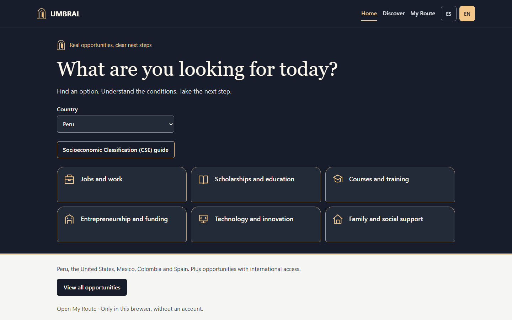
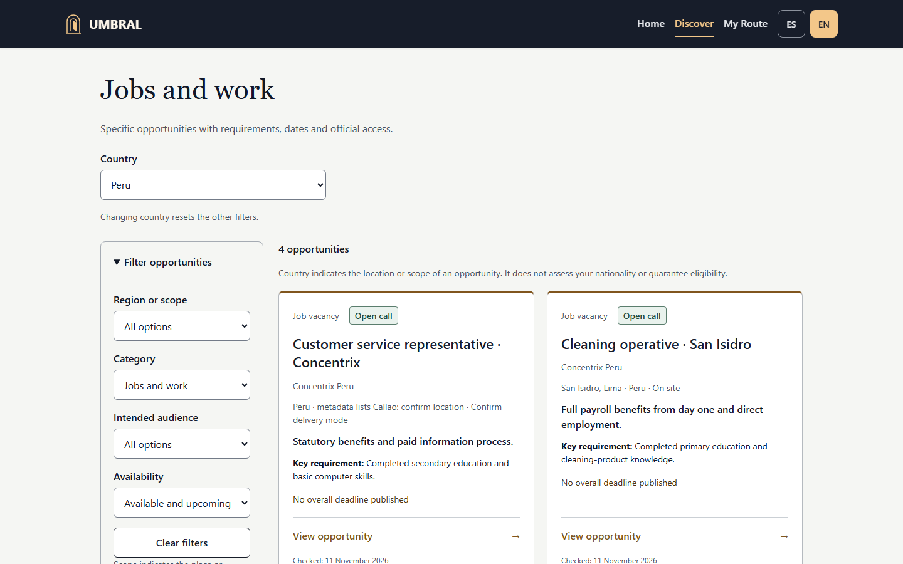
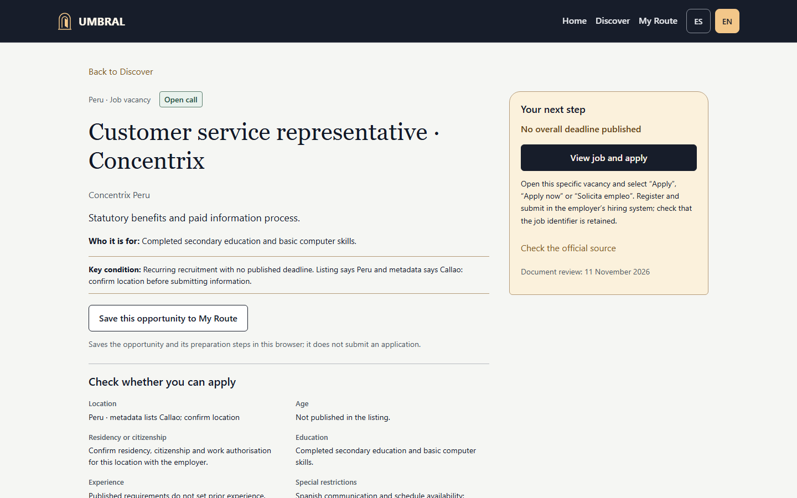
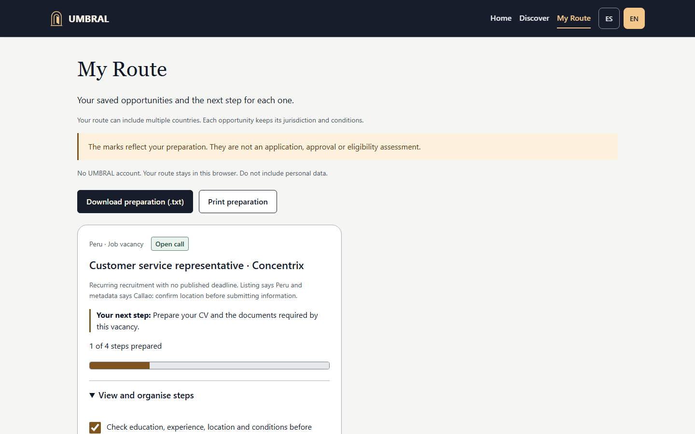
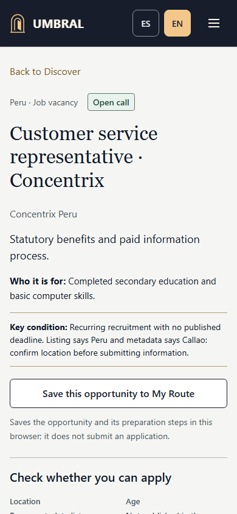
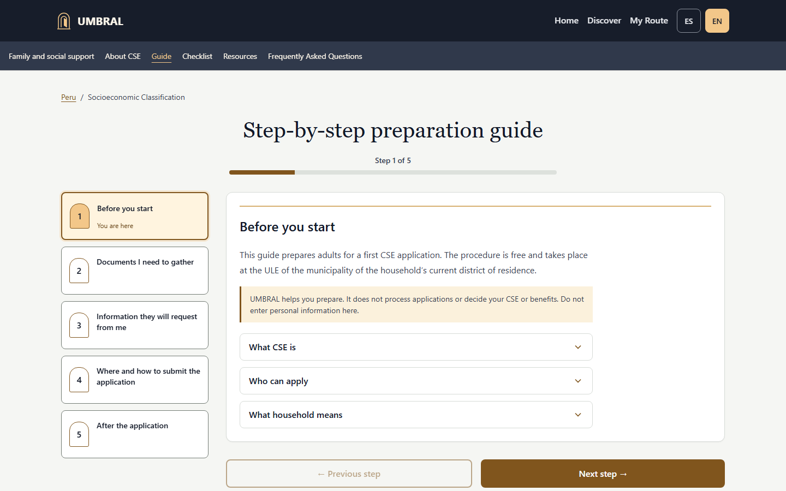

# UMBRAL — The Illuminated Threshold

**Find real opportunities. Understand the requirements. Take the next step.**

[Open UMBRAL](https://umbral-seven-khaki.vercel.app) · [Español](README.es.md) · [Submission overview](docs/kiroween-submission/PROJECT-OVERVIEW.md) · [GitHub](https://github.com/Alvaro-mendoza-12/Umbral)

UMBRAL is a bilingual opportunity companion for students, jobseekers, learners, entrepreneurs and households. It brings specific opportunities, dated official sources and a practical preparation route together without requiring an account.

Finding a programme name often leaves essential questions unanswered: What does it offer? Who can access it? What does it cost? What should I do next? UMBRAL organises those details, labels information an institution has not published, and lets a person save the next steps on their device. This is a product hypothesis; interviews and measured social outcomes have not been established.



## From discovery to preparation

1. Choose a country and browse categories or catalogue filters. Choose English or Spanish independently of the country.
2. Open an opportunity. Read its benefit, audience and key condition, then save it to **My Route** if useful. The Peru CSE entry also exposes its guide early.
3. Review eligibility, restrictions, costs, dates and official sources. Full eligibility remains available before the official application step; saving does not establish eligibility.
4. In My Route, mark preparation steps, add personal tasks and track progress. Download a text copy or print the route.
5. Continue through the institution's official link to apply, enrol or request. UMBRAL does not submit it for you.

## Countries and catalogue

The editorial snapshot reviewed on **11 November 2026** contains **31 concrete opportunities plus the Peru CSE procedure**, including **15 job listings**: Peru 4, United States 2, Mexico 3, Colombia 3 and Spain 3. International opportunities appear for countries explicitly included in their access conditions. Selecting English does not change jurisdiction or make an offer available worldwide.

The six categories are employment, education, training, entrepreneurship, technology and family support. Coverage varies by country and category; empty states explain missing records. Scholarships distinguish full and partial funding; courses distinguish free, paid and professional certificate offers. Entrepreneurship records identify their actual support type rather than treating loans, training and investment as interchangeable.

The catalogue is editorial, not a live feed. It contains closed records: **31 does not mean 31 currently open offers**. Closed and unconfirmed records are excluded from default discovery. Published deadlines affect availability; overdue editorial reviews change records to “Requires confirmation” and remove the application action. General portals are supplementary resources. Recheck institutional sources before acting. **Editorial re-verification is needed before submission and judging**: some job reviews are due on 14 November 2026 and become unconfirmed the following day if not refreshed, before the judging period.




## Features

- English and Spanish content, with country and language preferences saved independently.
- Specific opportunities with benefits, conditions, status, official links and dated documentary sources.
- My Route: local saves, preparation steps, personal tasks, progress, text download and printing.
- Peru CSE guidance: five steps, eleven preparation checkboxes, resources and FAQs. Chiclayo office details apply only to that district.
- Installable PWA and cached reading after a first complete online load. External websites require a network connection.
- Responsive layouts, keyboard navigation, route focus management, semantic controls, reduced-motion handling and automated accessibility checks. These do not certify full WCAG conformance.




## The Illuminated Threshold

The interface uses a mysterious night palette, a warm illuminated threshold, arch icons, gateway-like opportunity cards and visible preparation progress. The metaphor connects finding an opportunity with taking the next step. The proposed Kiroween category is **Costume Contest**. The owner approved this direction; its effect on usability has not been measured. See the [category justification](docs/kiroween-submission/CATEGORY-JUSTIFICATION.md).



## Architecture and stack

A static **React 18 + TypeScript + Vite** application uses React Router for navigation, i18next/react-i18next for English and Spanish, and Vite PWA/Workbox for precaching. Browser `localStorage` holds preferences, My Route and checklist state. There is no application backend, account system or runtime AI API. Vercel serves the static build with SPA routing and security headers.

| Area | Location |
|---|---|
| Routes and route accessibility | [`src/App.tsx`](src/App.tsx) |
| Opportunity types and status/filter rules | [`src/features/opportunities/domain/`](src/features/opportunities/domain/) |
| Editorial catalogue and source records | [`src/features/opportunities/data/`](src/features/opportunities/data/) |
| Country and saved-route state | [`src/features/opportunities/application/`](src/features/opportunities/application/) |
| Home, catalogue, detail and My Route | [`src/features/opportunities/pages/`](src/features/opportunities/pages/) |
| Peru CSE content and sources | [`src/content/pe/cse/`](src/content/pe/cse/) |
| Tests and CI | [`tests/`](tests/), [Quality workflow](.github/workflows/quality.yml) |

See [technical architecture](docs/kiroween-submission/TECHNICAL-ARCHITECTURE.md) for data flow and maintenance boundaries.

## Kiro and Codex contributions

Kiro created the initial MVP: the React/TypeScript implementation, original CSE experience, bilingual content, PWA setup, initial tests and reports. Its authentic [three Specs](.kiro/specs/umbral/) and [five Steering files](.kiro/steering/) remain with their original content.

Codex performed independent audit and remediation, accessibility and regression work, catalogue and international expansion, The Illuminated Threshold theme, later interaction fixes and publication preparation. These later changes are not attributed to Kiro. No unobserved Kiro Agent Hooks, MCP, Crew or property-based testing are claimed. Read the [attribution record](audit/ATTRIBUTION.md) for evidence and limits.

## Install and run

Use **Node.js 26.x** and npm from this repository's root. The engine also accepts Node 24.15.0+ within 24.x. No keys, secrets or environment variables are required.

```sh
npm ci
npm run dev
```

Open Vite's printed local URL. For a production build and local preview:

```sh
npm run build
npm run preview
```

Offline behavior must be tested against the built preview or production after a complete online load; the development server is not the PWA offline test.

## Verification

```sh
npm run lint
npm run test -- --run
npm run build
npm audit --omit=dev --audit-level=moderate
npx playwright install chromium
npm run test:e2e
```

The lockfile pins Playwright **1.65.0**; CI uses its matching Chromium image. Local E2E builds the app and starts an isolated preview at `127.0.0.1:5186`. Use new `UMBRAL_RESULTS_DIR` and `UMBRAL_SCREENSHOTS_DIR` output directories to preserve earlier evidence. See the [testing guide](docs/kiroween-submission/TESTING-INSTRUCTIONS-EN.md).

Recorded checks on **11 November 2026**: **49 unit tests**, **484 local E2E passes**, and **86 production E2E passes** on 390 px and 1440 px layouts. The [main Quality run](https://github.com/Alvaro-mendoza-12/Umbral/actions/runs/43136483189) succeeded. [Quality evidence](docs/kiroween-submission/evidence/quality-tests.json), [production evidence](docs/kiroween-submission/evidence/production-tests.json) and the [deployment record](docs/kiroween-submission/evidence/production.json) identify the tested state. These are dated results, not guarantees about future listings. Documentation edits do not constitute a new application test run. Mobile checks used browser emulation, not physical devices.

## Privacy, security and limits

Saved routes and task text stay in browser storage, without cloud sync or account recovery. Clearing site data or changing browser/device can lose the state. Avoid entering identity numbers, financial details or other sensitive information in tasks. A shared device can expose local content. Downloads and printed copies are controlled by the user.

UMBRAL does not request identity documents, income or addresses to assess eligibility. The host may process technical request metadata; official external sites apply their own policies. Absolute anonymity is not promised. Static hosting, dependency checks and deployment headers address specific risks without establishing a general security certification.

CSE is preparation guidance for Peru. UMBRAL does not calculate or request CSE, consult government registers, award benefits or replace a **ULE**. Checklist completion and route progress measure preparation only. There is no automated application, eligibility assessment, institutional synchronisation, deadline notification or AI recommendation engine. Documentary review cannot guarantee an offer stays open or an application succeeds.

## Submission, historical evidence and licence

The [submission package](docs/kiroween-submission/PROJECT-OVERVIEW.md) contains the English description, category case, judging matrix and paste-ready Devpost material. Public YouTube publication and the actual Devpost submission remain owner actions until their URL/status is recorded. Technical publication alone does not certify competition eligibility.

The [10 November audit](audit/REPORT.md), [earlier product review](audit/product-review/REPORT.md), and original `INFORME_FINAL.md`, `QA-REPORT.md`, `QA-SUMMARY.md` and `RESUMEN_EJECUTIVO.md` describe earlier phases. Their previews, screenshots, scope and conclusions are historical evidence, not current product descriptions. Human usability sessions and measured reductions in visits or effort have not been demonstrated.

Licensed under [MIT](LICENSE). Institutions remain responsible for their programmes and materials; UMBRAL is an independent guide.
