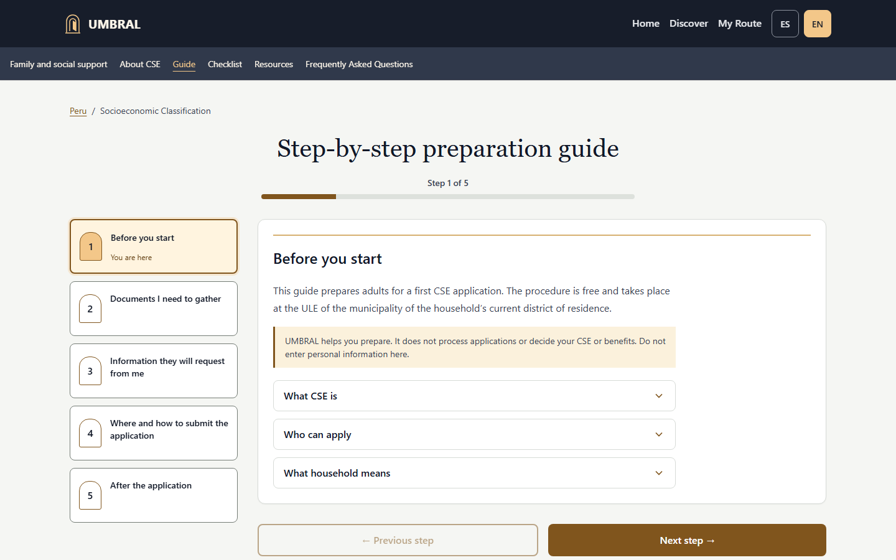

# Category justification: Costume Contest

**Proposed category: Costume Contest.** UMBRAL's case is the owner-approved **The Illuminated Threshold** interface applied to a functional opportunity companion. This is a qualified submission rationale, not an organiser eligibility determination.

The [official Kiroween rules](https://kiroween.devpost.com/rules), reviewed for this package on **11 November 2026**, are the authority for category and submission requirements. The competition's [category descriptions](https://kiroween.devpost.com/) guide the interpretation below.

## The costume in the actual product

UMBRAL means threshold. The interface frames opportunities as entrances to a possible next step: a mysterious night palette surrounds a warm illuminated threshold, arch icons repeat the entrance motif, and gateway-like cards lead into opportunity details. My Route turns a saved possibility into visible preparation progress.

| Visible element | Intended functional role | Demonstration |
|---|---|---|
| Warm illuminated threshold against a night palette | Establish a clear visual starting point and the theme of moving toward an opportunity | Show the working home at desktop and mobile widths. |
| Arch icons and gateway cards | Carry the same metaphor from categories into discovery | Select a country/category and open a real opportunity card. |
| Benefit, key condition and early save | Give the “next step” a concrete action without forcing every detail into the opening summary | Show summary, save and then eligibility before the official application action. |
| Preparation steps and progress | Extend the threshold story into the person's own route | Mark a step, add a task and show progress. |
| Responsive controls and reduced motion | Keep the themed experience usable across the tested layouts | Show mobile navigation and keyboard interaction. |

## How strongly the evidence supports the category

The project has a coherent visual theme linked to discovery and preparation, rather than only a themed project title. Its functional rationale is visible in the live flow. The owner approved this direction, and software tests cover relevant behavior and accessibility checks.

The Halloween connection is atmospheric and restrained. It is not a strong horror experience. We have not conducted a controlled study or human usability sessions to prove that the costume improves comprehension, completion rates or confidence. The submission should say that these elements **are intended to support** navigation and preparation, and demonstrate how they work. It should not claim a measured improvement or guaranteed category acceptance.

## Why other categories are not claimed

No evidence establishes resurrection of obsolete technology, a combination of apparently incompatible technologies sufficient for a Frankenstein claim, or a reusable skeleton demonstrated by two distinct applications for Skeleton Crew. A static PWA, official sources and typed content do not establish those categories on their own. UMBRAL should not stretch its architecture or development history to claim them.

## Presentation choice

Show the night-and-threshold home, follow a gateway card into a real opportunity, save after the key condition, review eligibility, and mark a preparation step. Pair the screen with the plain explanation: **“The Illuminated Threshold connects discovering an opportunity with preparing the next step.”** Keep authorship separate: Kiro created the initial MVP; Codex implemented the later theme and international/catalogue work.

The organiser decides fit under the official rules. Public product availability and passing tests do not replace that decision.
