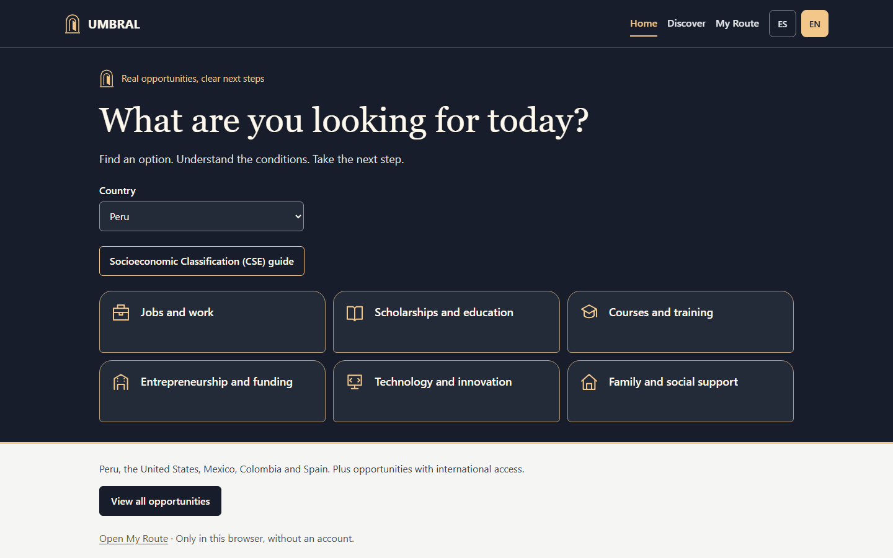

# UMBRAL — The Illuminated Threshold

**Find real opportunities. Understand the requirements. Take the next step.**

UMBRAL turns opportunity discovery into a practical preparation route. Students, jobseekers, learners, entrepreneurs and households can browse specific opportunities, understand conditions, save useful ones locally and organise their next steps without creating an account.

| Item | Current submission reference |
|---|---|
| Working product | [umbral-seven-khaki.vercel.app](https://umbral-seven-khaki.vercel.app) |
| Public source | [Alvaro-mendoza-12/Umbral](https://github.com/Alvaro-mendoza-12/Umbral) |
| Production application commit | [`5c77941542c1b498c37639a2d03a26dd8fbfee42`](https://github.com/Alvaro-mendoza-12/Umbral/commit/5c77941542c1b498c37639a2d03a26dd8fbfee42) |
| Primary language | English; Spanish product content and [Spanish README](../../README.es.md) also available |
| Proposed category | Costume Contest, with the qualified case below |
| Licence | [MIT](../../LICENSE) |
| Public YouTube video | **[OWNER: PUBLIC YOUTUBE URL REQUIRED]** |
| Submission status | Prepared materials; no Devpost submission represented as completed |

## What judges can use

- [English project description](PROJECT-DESCRIPTION-EN.md): a complete narrative for the submission.
- [Problem and solution](PROBLEM-AND-SOLUTION.md), [features](FEATURES.md) and [technical architecture](TECHNICAL-ARCHITECTURE.md): product scope and implementation.
- [Category justification](CATEGORY-JUSTIFICATION.md): how the visual threshold metaphor relates to the working experience.
- [Testing instructions](TESTING-INSTRUCTIONS-EN.md): public demo flow, reproducible commands and dated results.
- [Devpost fields](DEVPOST-FIELDS.md): paste-ready English content and explicit owner placeholders.
- [Judging matrix](JUDGING-MATRIX.md): evidence, weaknesses and demonstration choices for the five equal criteria.
- [Attribution](../../audit/ATTRIBUTION.md): authentic Kiro artifacts and the separate Codex contribution.

## Actual product scope

The **11 November 2026** editorial snapshot contains **31 concrete opportunities plus Peru's CSE procedure**, including 15 jobs: Peru 4, United States 2, Mexico 3, Colombia 3 and Spain 3. International entries are country-qualified. The six categories are employment, education, training, entrepreneurship, technology and family support. Country and language are independent preferences; an English interface does not change a programme's jurisdiction.

This is a curated snapshot with closed records and uneven coverage, not 31 live offers or a complete international directory. Closed and unconfirmed records are excluded from default discovery. Dates and editorial review deadlines affect availability. Some job reviews are due on **14 November 2026** and become unconfirmed the following day if not refreshed, so the catalogue needs editorial re-verification before submission and judging. Recorded media documents the state on its capture date.

My Route saves opportunities, preparation steps and personal tasks in browser storage. Users can track progress, download text and print. Save appears after the benefit and key condition; full eligibility remains available before the official application step. Saving and progress do not establish eligibility. Peru CSE has an early guide link, a five-step guide, eleven preparation checkboxes, sources and FAQs. UMBRAL does not calculate CSE or replace a ULE.

## Visual direction and authorship

The owner-approved **The Illuminated Threshold** direction uses a mysterious night palette, a warm arch, gateway cards and preparation progress. These visual cues support a proposed Costume Contest case. They do not establish measured usability improvement or guarantee a category decision by the organisers.

Kiro created the initial React/TypeScript CSE MVP, PWA, bilingual content, tests and the original three Specs/five Steering files. Codex handled later audit, corrections, accessibility and regression work, catalogue/international expansion, theme, interaction fixes and publication preparation. No unsupported Agent Hooks, MCP, Crew or property-based testing claims are made. There is no AI API in the deployed runtime.

## Verification and remaining owner work

Recorded on **11 November 2026**: 49 unit tests, 484 local E2E passes and 86 production E2E passes at 390 px and 1440 px. [Main CI succeeded](https://github.com/Alvaro-mendoza-12/Umbral/actions/runs/43136483189). See [quality](evidence/quality-tests.json), [production tests](evidence/production-tests.json), [deployment](evidence/production.json) and [CI](evidence/ci.json) evidence. This documentation preparation did not rerun application tests.

The owner must supply the public YouTube URL, verify the actual Devpost form, complete any missing personal/bonus evidence, recheck catalogue freshness and submit. No account details, eligibility determination, organiser approval, human interviews or impact measurements are invented.

