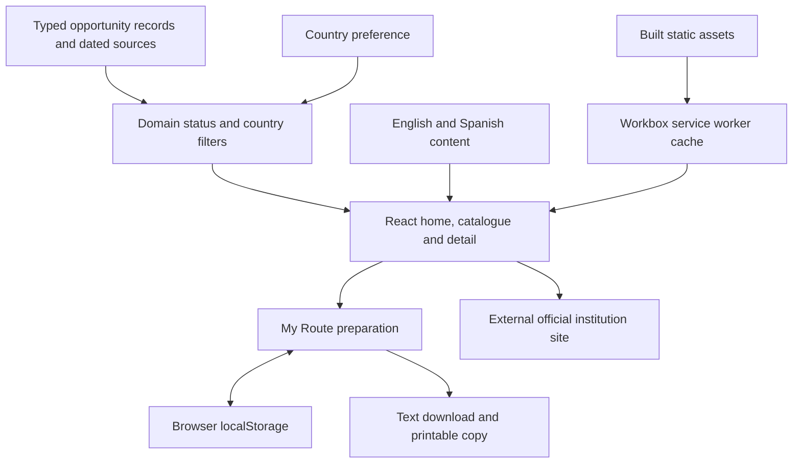

# Technical architecture

UMBRAL is a static React/TypeScript application deployed on [Vercel](https://umbral-seven-khaki.vercel.app). The application state and catalogue are intentionally separate: editorial facts describe institutions and opportunities; domain functions determine status and discovery; browser state holds the user's preparation.

External application sites are independent services; they are not backend integrations. Offline access applies to cached application reading after a complete online load, not to those external sites.

## Stack

| Concern | Implementation |
|---|---|
| UI and types | React 18, TypeScript, CSS modules and shared design tokens |
| Build | Vite and TypeScript build checking |
| Navigation | React Router; route titles and focus handling in `src/App.tsx` |
| Translation | i18next, react-i18next and language detection/normalisation |
| PWA | Vite PWA plugin and Workbox precaching |
| User state | Browser localStorage with validation/normalisation and unavailable-storage feedback |
| Unit/component tests | Vitest and Testing Library |
| Browser tests | Playwright 1.65.0 from the lockfile, Chromium and axe |
| Hosting and CI | Vercel static deployment; GitHub Actions Quality workflow |

Node 26.x is the documented reproducible runtime; the package engine also permits Node 24.15.0+ within 24.x. CI pins a Playwright image matching the locked browser tooling. No runtime AI API, database, account service or application server is required.

## Source boundaries

- [`src/features/opportunities/domain/types.ts`](../../src/features/opportunities/domain/types.ts) defines opportunities, access facts, source references, statuses, filters and saved-route types.
- [`data/catalog.ts`](../../src/features/opportunities/data/catalog.ts) combines verified concrete opportunities with retained Peru records. Supplementary portals are marked separately. Source and institution identifiers are explicit.
- [`domain/catalog.ts`](../../src/features/opportunities/domain/catalog.ts) computes availability, country matching, filter results and whether an official action is allowed.
- [`application/`](../../src/features/opportunities/application/) separates country preference and route state from page components. Saving creates local preparation state, not an application record.
- [`pages/`](../../src/features/opportunities/pages/) contains home, discovery, detail and My Route. Detail places the benefit/key condition and save before full eligibility; full eligibility remains before the official application action.
- [`src/content/pe/cse/`](../../src/content/pe/cse/) contains Peru CSE content, source references and checklist content. It preserves jurisdiction boundaries independently of translation.
- [`src/utils/print.ts`](../../src/utils/print.ts) supports printable content. My Route generates a text file in the browser.

## Country, language and access

Country selection controls the discovery context. Language selection controls translated text. These preferences persist separately. A record matches its own country or an explicitly eligible country on a qualified international entry; translation does not widen access. Local CSE guidance for Chiclayo is not reused as an office directory for another district or country.

## Availability and editorial maintenance

The status function evaluates published deadline times/dates, editorial `reviewBy`, opening dates and the recorded availability state. Default discovery includes open, ongoing and upcoming concrete records; closed/unconfirmed records and supplementary portals are excluded. Only open/ongoing eligible records expose an official action. An overdue editorial review becomes unconfirmed; it is not automatically reverified.

The 11 November 2026 snapshot contains 31 concrete opportunities plus CSE, including closed records. Some job reviews are due on **14 November 2026** and become unconfirmed the following day if not refreshed. Rechecking institution pages before submission and judging is necessary; neither a build nor CI refreshes external facts. The catalogue does not scrape institutions, synchronise applications or send deadline alerts.

## Local state and privacy

My Route stores opportunity IDs, completed step IDs and personal tasks. The route normaliser validates persisted data rather than trusting arbitrary stored objects. Country, language and the CSE checklist also persist locally. A browser with storage disabled reports the limitation; the app should not imply durable saving in that case.

Local storage is neither encrypted account storage nor cross-device backup. Shared-device users can expose their task text, and clearing site data can remove progress. The product does not require identity numbers, addresses, income or document uploads to evaluate eligibility. Users should avoid sensitive task text. Text exports and prints leave browser storage under user control. Hosting can process technical request metadata; external sites have their own privacy policies.

## Deployment and evidence

The Vite build creates static assets and the PWA manifest/cache. [`vercel.json`](../../vercel.json) supplies SPA routing and deployment headers. No secrets or runtime environment variables are required. Development-server behavior is not proof of production offline operation.

Recorded application state: production commit [`5c77941542c1b498c37639a2d03a26dd8fbfee42`](https://github.com/Alvaro-mendoza-12/Umbral/commit/5c77941542c1b498c37639a2d03a26dd8fbfee42); [successful main Quality run](https://github.com/Alvaro-mendoza-12/Umbral/actions/runs/43136483189). See [quality evidence](evidence/quality-tests.json), [production evidence](evidence/production-tests.json) and [deployment](evidence/production.json).

Kiro's original three Specs and five Steering files remain unchanged. Later audit, catalogue/international architecture, theme, accessibility/regressions and publication work are attributed to Codex in the [attribution record](../../audit/ATTRIBUTION.md). The runtime is not an AI agent system.
